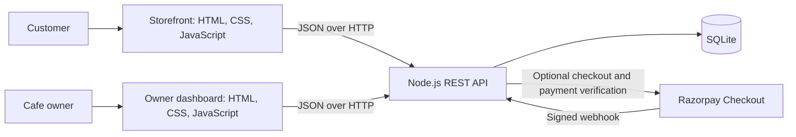

# Brew & Bite — Full-Stack Café Ordering Platform

**Live demo:** [Brew & Bite on GitHub Pages](https://yash301201.github.io/Brew-bit-website/) · **Source:** [GitHub repository](https://github.com/Yash301201/Brew-bit-website)

A full-stack café ordering and reservation application with a customer storefront, private owner dashboard, Node.js REST API, and SQLite persistence. Guests can discover menu items, place pickup or dine-in orders, request reservations, and submit reviews; owners can manage operations from one dashboard. Razorpay Checkout is available as an optional payment integration.

> **Project status:** This is a working MVP and portfolio project. Replace the sample café details and complete the launch checklist before using it for a real business or accepting live payments.

## Features

### For guests

- Browse, search, sort, filter, and save menu favourites.
- Add menu items to a bag and submit a pickup or dine-in order.
- Request a table reservation; the server checks opening hours, party size, future dates, and available seating.
- Choose pay-at-café or, when configured, pay online through Razorpay Checkout.
- Send a review for owner moderation.

### For the café owner

- Sign in to a private dashboard to review orders, sales, bookings, and payment references.
- Update order and booking statuses, record in-person payments, and moderate reviews.
- View a seven-day sales chart and popular menu items.
- Update menu availability and prices, and change the owner password.

Sales totals include captured online payments and in-person payments recorded by the owner. Reconcile dashboard figures with payment-provider settlements and the café's cash register. Refunds and tax invoices are not automated.

## Technology

- HTML, CSS, and browser JavaScript
- Node.js 22.13 or later, using the built-in SQLite module
- SQLite for local application data
- Razorpay Standard Checkout as an optional online-payment integration

There are no third-party Node package dependencies to install.

## Architecture



The storefront and owner dashboard are separate browser clients that share the server API. Payment checkout remains disabled until provider credentials are configured.

## Run locally

Install Node.js 22.13 or later, then open a terminal in the project folder.

**Windows PowerShell**

```powershell
Copy-Item .env.example .env
```

**macOS or Linux**

```sh
cp .env.example .env
```

Edit `.env` before starting the server:

1. Set a real `ADMIN_EMAIL` and a unique `ADMIN_PASSWORD` of at least 14 characters. Do not use the example value.
2. Review the café name, time zone, opening hours, and table capacity.
3. Keep payment credentials empty unless you are setting up Razorpay test mode.

Start the app:

```sh
npm start
```

With `npm start` running, open `http://localhost:4173` for the customer site or `http://localhost:4173/admin` for the owner dashboard on the same computer. If you see `ERR_CONNECTION_REFUSED`, start the server from the project folder first.

These addresses are for local development only. A recruiter should use the [live demo](https://yash301201.github.io/Brew-bit-website/) above; a localhost address always points to the visitor's own computer.

The server creates `data/brew-bite.sqlite` on first run. The database and `.env` are excluded from Git. Keep secure backups of the database; the first owner account is created when the database has no owner yet. Change the password later from **Owner dashboard → Account**.

For local development with automatic server restarts, run `npm run dev`. Run `npm run check` for JavaScript syntax checks; it is not a full automated test suite.

## Live portfolio preview

The preview showcases the storefront, photography, and searchable café menu. It is hosted as a static GitHub Pages site, so it does not run the Node.js API or SQLite database. Orders, table bookings, reviews, online payments, and the owner dashboard need the backend and are unavailable in this preview. See [GITHUB_PAGES.md](GITHUB_PAGES.md) for details.

## Optional online payments

Razorpay checkout stays off until `RAZORPAY_KEY_ID` and `RAZORPAY_KEY_SECRET` are configured. Begin with test credentials. The server creates provider orders, verifies checkout signatures and payment status, and accepts signed, deduplicated webhooks at `/api/payments/webhook`. Payment details such as card numbers and CVVs are handled by the provider and are not stored by this site.

To test webhooks, configure the provider dashboard with a public staging URL ending in `/api/payments/webhook` and set a separate `RAZORPAY_WEBHOOK_SECRET`. A local server cannot receive provider webhooks directly. Use HTTPS and set `APP_ORIGIN` to the deployed site's exact origin before testing a deployment. Follow the official [Standard Checkout integration guide](https://razorpay.com/docs/payments/payment-gateway/web-integration/standard/) and [checkout configuration guide](https://razorpay.com/docs/payments/payment-gateway/web-integration/standard/configure-dashboard/checkout/).

## Before a public launch

- Replace sample menu prices and confirm tax treatment, allergens, stock, and service cut-off rules.
- Add the real address, map pin, contact details, hours, reservation duration, and cancellation policy.
- Configure a durable server disk, encrypted database backups, monitoring, HTTPS, and a tested restore process. This single-process SQLite setup is intended for a first café deployment; use a managed database before running multiple app instances or when operational needs outgrow one durable SQLite database.
- Complete payment-provider onboarding and test successful payments, failures, refunds, webhook delivery, and settlement reconciliation before enabling live credentials.
- Publish the café's privacy, terms, refund, cancellation, and contact information, and review the live flow against local business and payment requirements.

## Project structure

| Path | Purpose |
| --- | --- |
| `index.html`, `style.css`, `script.js`, `menu-data.js` | Customer-facing website and menu |
| `admin.html`, `admin.css`, `admin.js` | Private owner dashboard |
| `server.mjs` | HTTP API, SQLite database, authentication, bookings, orders, and payment integration |
| `images/`, `photo-credits.html` | Website photography and attribution |
| `data/brew-bite.sqlite` | Local database created at runtime; not committed |
| `photo_*.py`, `wire_photos.py`, and related utilities | Photo preparation scripts; not required to run the site |

Thirty-four selected menu images are AI-generated and identified on the photo credits page.

## License

No license is included yet. Contact the repository owner before reusing or redistributing this project.
